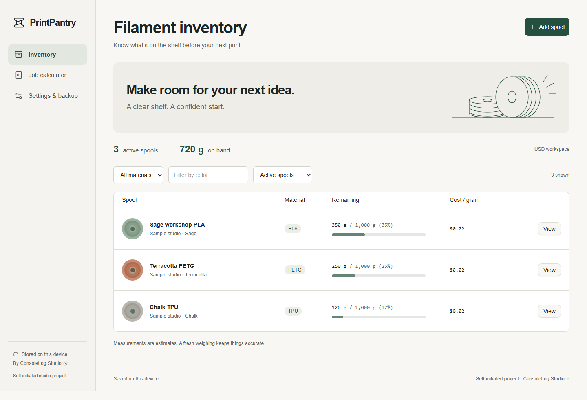
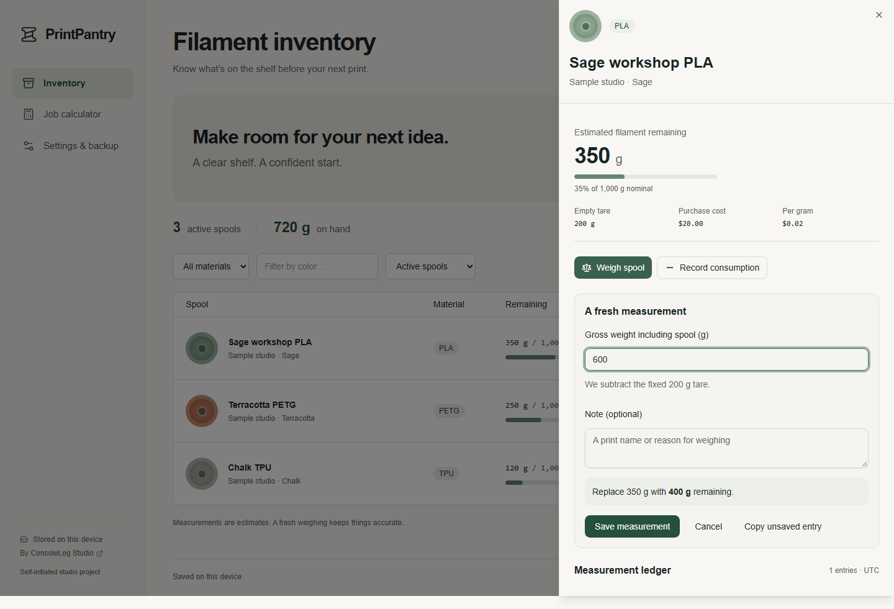
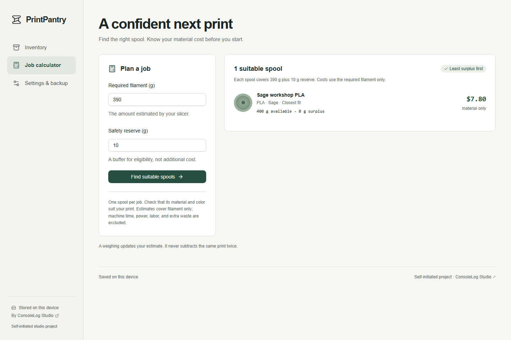
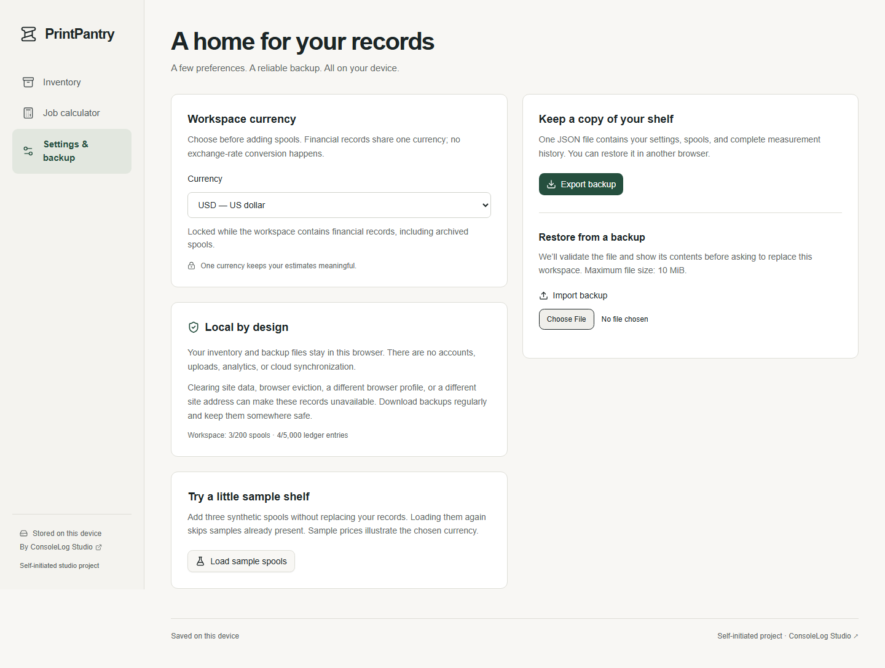
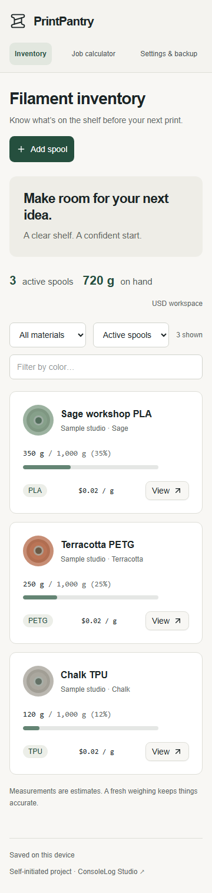

# PrintPantry: a clearer shelf before the next print

**Self-initiated studio project · ConsoleLog Studio**

PrintPantry is a working portfolio concept for small 3D print workshops and maker businesses. It demonstrates an operational workflow and engineering decisions; it is not a commissioned client project or evidence of validated demand.

## The workflow problem

A partial spool may look sufficient until a slicer’s estimated requirement and a safety reserve are considered together. Operators also need an understandable material estimate without confusing filament cost with a complete job quote.

PrintPantry connects a small inventory ledger to a job calculator. A fresh weighing replaces the current estimate, manual consumption records reduce it, and the calculator finds a single active spool with sufficient material.

## Five annotated screens

### 1. The shelf at a glance

**Read the remaining column:** grams, nominal capacity, percentage, and a visual bar describe the same estimate. Material/color/status filters narrow the shelf. All three records and prices shown are synthetic fixtures.

### 2. A measurement the operator can review

**Follow the measurement preview:** 600 g gross minus 200 g empty-spool tare gives 400 g filament. The app explicitly previews replacement of the old 350 g estimate. It commits only after Save measurement succeeds.

### 3. From uncertainty to one suitable spool

**Compare availability with the requirement:** 390 g required plus 10 g reserve now fits the 400 g spool exactly. The material estimate is $7.80 at $20.00 per 1,000 g. The reserve affects eligibility without being charged as consumed filament.

### 4. Recovery is part of the product

**Use the backup controls:** export settings and the complete ledger in one JSON file. Restore validates the file, previews counts, and asks to replace the workspace. A failed or stale import preserves the current data.

### 5. The same shelf on a phone

**Compare with the desktop table:** phone cards preserve name, material, color, mass, cost, and the details action without page-level horizontal scrolling. Color is supported by text labels.

## Decisions that affect the operator

- **Local storage:** data remains in the browser. The app needs no account, cloud database, or runtime processing API. The tradeoff is that browser data needs downloaded backups and does not sync between devices.
- **A readable ledger:** weighing and consumption have distinct meanings. History is append-only, and a new measurement corrects the estimate without applying an old print twice.
- **Exact quantities:** integer mass and money, with BigInt intermediate arithmetic, avoid decimal drift and define final cost rounding.
- **Atomic writes:** creation, deletion, and import use transactions and revision checks so a failed write or stale tab cannot silently overwrite records.
- **A bounded interface:** matching results and long ledgers reveal entries in small groups while retaining the full sorted result/history.
- **Zero mandatory infrastructure spend:** Next.js exports static files for the selected Cloudflare Pages Free deployment. The app has no paid API or runtime dependency.

## Verification and limits

See [the acceptance evidence](verification.md) for recorded test results, browser versions, performance measurements, and checks not run. The tests use synthetic data and simulated storage failures. WebKit automation does not establish real Safari compatibility; no physical printer or scale integration is claimed.

Material estimates exclude machine time, power, labor, and waste beyond the requirement. Maximum workspace size is 200 spools, 5,000 ledger events, and a 10 MiB backup. Local records are bound to one browser origin.

The [recorded walkthrough](portfolio/walkthrough.webm) shows the complete no-match → weigh → match workflow and backup export. Run the local demo using the repository README. Public hosting status is recorded in [deployment notes](deployment.md); no unverified public URL is presented here.

For an operational tool for your own team, visit [ConsoleLog Studio](https://consolelog.studio/).
